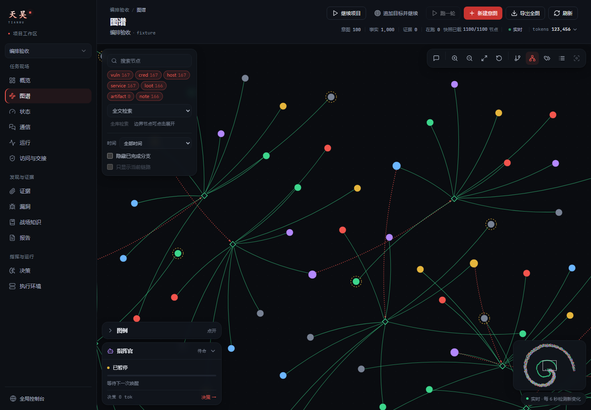
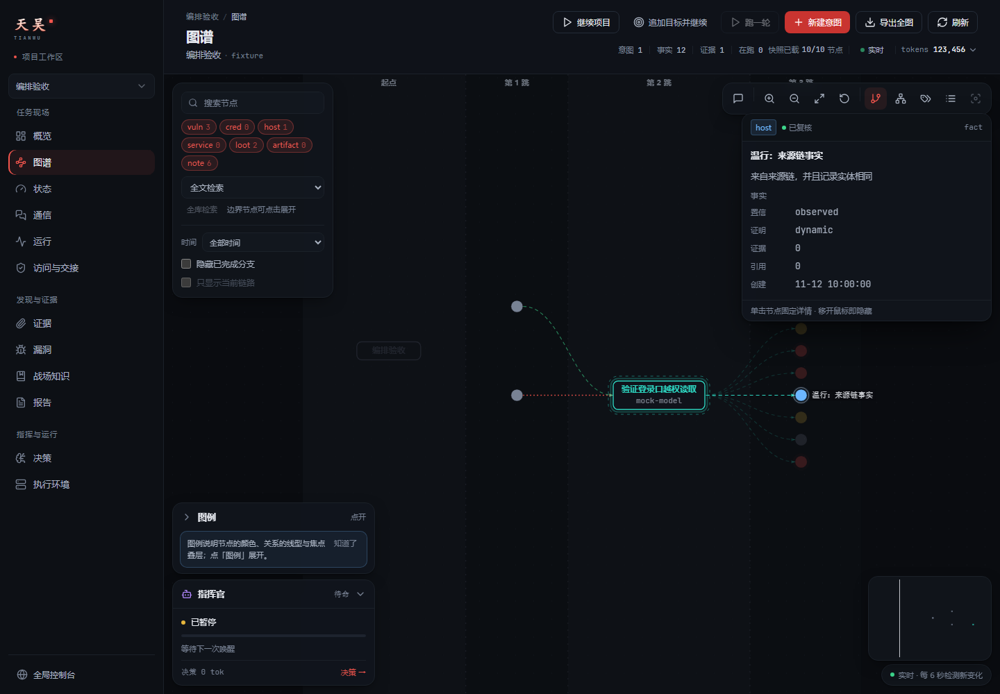
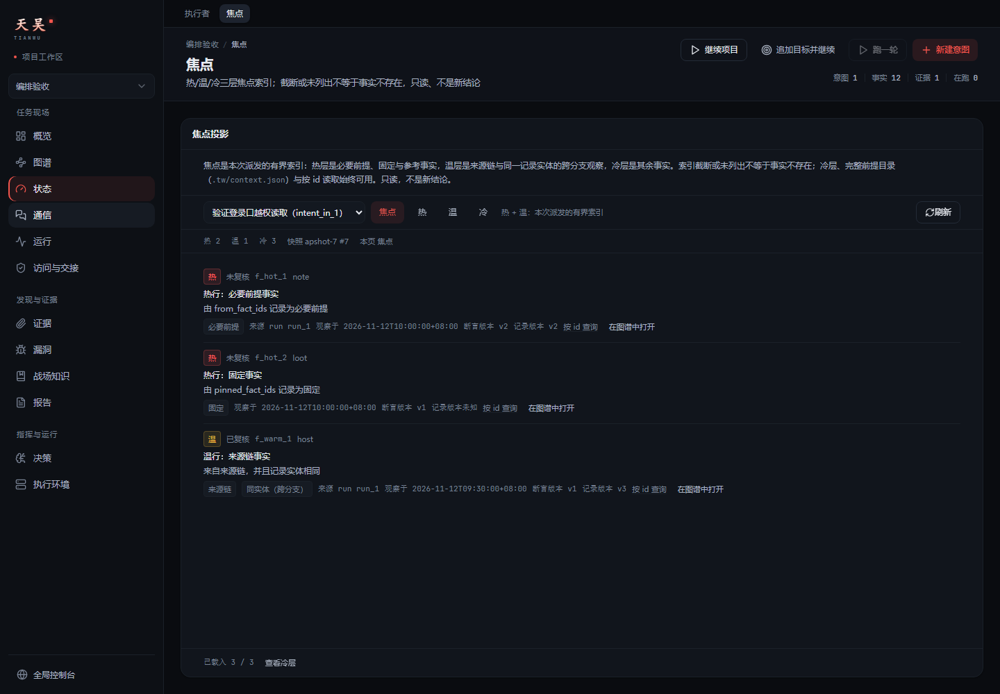
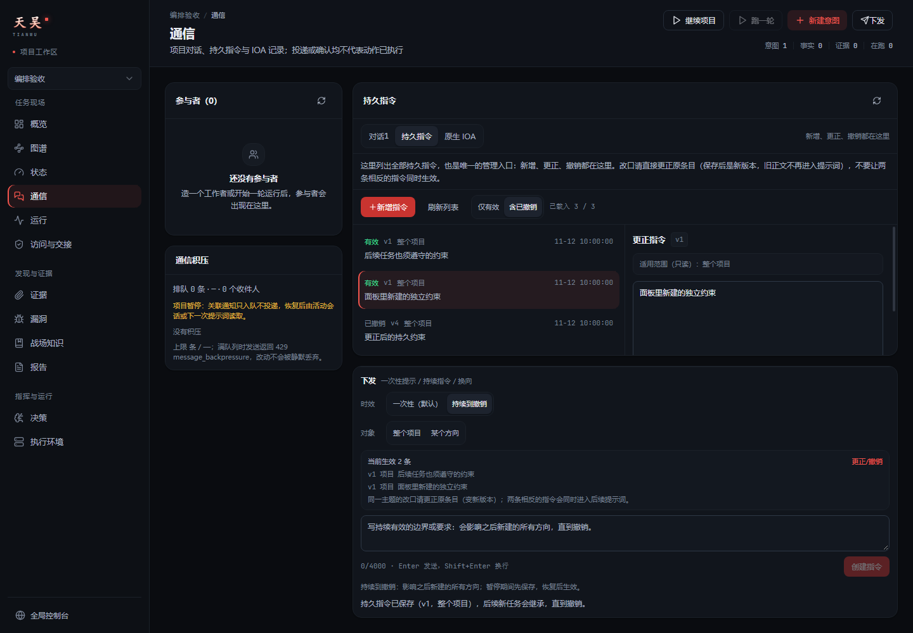
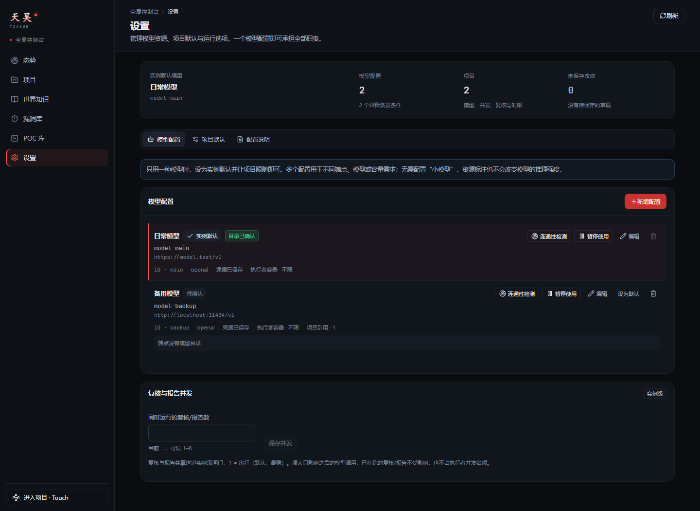
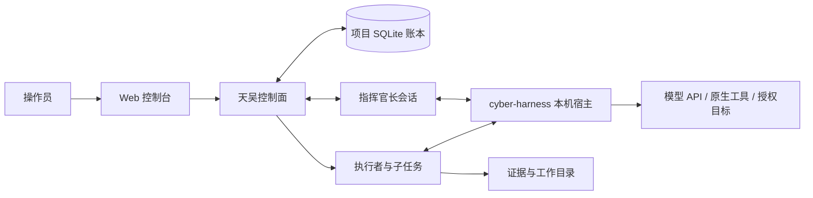

# 天吴 · Tianwu

面向授权安全测试的多 Agent 控制面。以意图组织任务，以事实和原始证据保存进展，让指挥官与多个执行者围绕同一项目持续协作。

天吴负责项目管理、任务调度、状态账本和人工监督；[cyber-harness](https://github.com/kksty/cyber-harness/tree/tianwu/fixes) 提供模型会话、原生工具与执行宿主。控制台可查看任务依赖、运行过程、模型用量、证据和报告，也可以暂停项目、追加目标或接管需要人工处理的事项。

[快速开始](#快速开始) · [界面](#界面) · [核心架构](docs/01-architecture.md) · [贡献指南](CONTRIBUTING.md) · [安全策略](SECURITY.md) · [免责声明](#免责声明) · [许可证](LICENSE)

> 当前为 0.x 预发布，面向单机、单用户使用。接口与数据格式仍可能调整。仅可用于已获明确授权的环境；请先阅读安全策略，并为每个项目写清测试范围和禁止事项。

## 界面

天吴把同一份账本投影成图谱、焦点、指令和运行视图。以下截图由离线 fixture 生成，使用合成目标和数据，**不含真实项目目标、凭据或运行记录**。

<p align="center">
  
</p>

<p align="center"><em>同一份账本投影成可缩放的攻击面图谱。合成 fixture：100 条方向、1,000 条事实；节点按类型着色，边区分产出、必要前提、引用与固定关系。</em></p>

<table>
<tr>
<td width="50%" valign="top">
  
  <p><sub><b>图谱与节点检查</b><br/>点开节点查看断言版本、复核状态、证据与关系；蓝色实线是必要前提，绿色虚线是引用/固定，未满足的前提不会被伪装成产出。</sub></p>
</td>
<td width="50%" valign="top">
  
  <p><sub><b>焦点投影</b><br/>把本轮相关事实分成热/温/冷三层，带断言版本、记录版本与来源 run，按 id 续读，不把“没列出来”当成“事实不存在”。</sub></p>
</td>
</tr>
<tr>
<td width="50%" valign="top">
  
  <p><sub><b>持久指令</b><br/>操作员的授权边界、禁止事项和长期约束进入每一轮；指挥官与执行者只能读取，不能创建、改写或撤销。</sub></p>
</td>
<td width="50%" valign="top">
  
  <p><sub><b>模型与执行环境</b><br/>多配置、层级选择、并发容量、暂停与恢复、显式连通性检测；一个配置可承担全部职责，替代模型不会改写历史绑定。</sub></p>
</td>
</tr>
</table>

## 核心能力

| 能力 | 说明 |
| --- | --- |
| 多 Agent 协作 | 指挥官长会话、并发执行者、子任务委派、同伴消息、等待与唤醒、换模型交接 |
| 持久项目状态 | SQLite 事务账本、记录修订、变化交付与确认、分页快照、事实与意图依赖图 |
| 证据与固定复核 | 结论关联原始材料；成功意图先进入复核阶段，新的 vuln/cred 结论通过独立复核后才完成，未通过进入可重试的 review_failed |
| 人工监督 | 项目暂停、持久指令、访问与人工交接、运行取消、终端与过程查看 |
| 模型管理 | 多配置与层级选择、API key 轮换、并发容量、配置暂停与恢复、显式连通性检测 |
| 内容资产 | 内置协作与报告 Skill、事实知识卡、实例级 Skill 和 POC 资源 |



## 快速开始

### 环境要求

- Go 1.26 或更高版本，以两个仓库的 `go.mod` 为准。
- Git，以及一个可用的模型 API。支持 OpenAI 兼容接口和 Anthropic Messages 接口，具体能力取决于供应商与模型。
- Windows 上需要 Git for Windows，并让 harness 能找到其附带的 Bash 与常用 POSIX 工具。
- 修改前端时需要 Node.js 24+ 和 pnpm；只构建 Go 控制面可使用已入库的前端产物。

### 1. 获取源码

```bash
git clone --recurse-submodules https://github.com/kksty/tianwu.git
git clone --branch tianwu/fixes https://github.com/kksty/cyber-harness.git
cd tianwu
```

`cyber-ui` 是控制台组件库子模块。已有 checkout 可运行 `git submodule update --init --recursive` 补齐。子模块指向 fork `kksty/cyber-ui` 的 `tianwu/console-tokens` 分支（控制台改版用到的主题 token / 排版调整），`origin` 就是这个 fork；上游仍是 `chainreactors/cyber-ui`，已配置为子模块的 `upstream` remote，需要同步时 `git -C cyber-ui fetch upstream && git -C cyber-ui merge upstream/main`，再把 token 分支继续维护。harness 独立维护，使用 fork 的 `tianwu/fixes` 分支；主项目仅维护 `main`。

### 2. 构建并启动

Windows / PowerShell：

```powershell
pwsh -File scripts/build-harness.ps1 -HarnessDir ../cyber-harness
go build -o bin/tw.exe ./cmd/tw
./bin/tw.exe --aiscan ./bin/aiscan-full.exe --data ./data
```

Linux / macOS：

```bash
HARNESS_DIR=../cyber-harness sh scripts/build-harness.sh
go build -o bin/tw ./cmd/tw
./bin/tw --aiscan ./bin/aiscan-full --data ./data
```

默认控制台地址为 `http://127.0.0.1:8080`。首次启动会生成登录令牌，保存在 `<data>/console.token`；使用该令牌登录。全新的数据目录会创建一个空白默认项目，不包含目标、发现或运行记录。

数据目录应为空目录或当前版本支持的 SQLite 项目目录。旧 JSON 账本、缺少 `ledger.sqlite` 的项目目录不会自动迁移；升级前请备份并确认兼容性，不要混用旧目录。

### 3. 配置模型与项目

1. 在「设置 → 模型」填写接口地址、API key、模型名称与上下文窗口，选择默认模型。
2. 点击「连通性检测」。检测会发送一次轻量推理请求，成功后展示接口实际返回的模型名称；接口未返回名称时明确显示未返回。模型目录查询只用于辅助选型，不能证明推理或工具调用可用。
3. 在项目设置中填写授权范围、测试时间、禁止动作和数据保护要求，再填写项目目标。
4. 检查模型、工具与权限后启动项目，关注待办、执行过程和证据；需要时暂停或人工接管。

模型配置可以暂停使用。暂停状态会保存到配置文件，该配置不再接受新调用；默认调用会自动选择其他可用模型，没有替代模型时明确提示。已开始的调用继续运行，配置、默认选择与现有宿主保留；恢复后新请求重新使用原默认模型。

测试约束用于表达授权边界。证据质量、线索与结论的区别属于角色执行契约，由执行者提示词和指挥官 Skill 统一规定，不依赖操作者复制模板。

### 常用启动参数

| 参数 | 默认值 / 用途 |
| --- | --- |
| `--addr` | `127.0.0.1:8080`，控制台监听地址 |
| `--data` | `./data`，实例数据目录 |
| `--aiscan` | harness 二进制路径；省略时从同目录及 PATH 查找 |
| `--harness-config` | 默认 `~/.cyber/cyber.yaml`；控制台模型设置直接读写该配置 |
| `--max-runs` | `3`，每项目默认执行者并发上限 |
| `--max-workers` | `0`，实例执行者总并发上限，0 表示不限 |
| `--round-timeout` | `15m`，指挥官单轮时限 |
| `--heartbeat` | `5m`，空闲心跳间隔 |
| `--no-decider` | 关闭自动指挥官，保留账本和手动派发 |

完整参数可运行 `tw --help` 查看。项目在进程重启后保持暂停，由操作员确认后恢复。启动和重启长期服务由操作员执行。

## 开发与验证

```bash
pnpm install
pnpm --dir web typecheck
pnpm --dir web test
pnpm --dir web build
go build ./...
go test ./...
go vet ./...
node scripts/check-docs.mjs
```

`internal/web/static` 由 Go 嵌入二进制，修改前端后需重新构建并提交产物。大部分测试使用临时账本和本地假模型，不调用外部模型。真实 harness 集成测试需要显式设置 `TW_AISCAN_BIN`，未设置时跳过；这些测试验证适配契约，不能代表真实目标上的测试效果。

维护资料：

- [核心架构](docs/01-architecture.md)：角色、数据、调度和验证边界。
- [界面截图](docs/screenshots/)：由 `scripts/acceptance` 的离线 fixture 生成，使用合成数据和目标，不含真实项目内容。
- [贡献指南](CONTRIBUTING.md)与[实现约定](agent.md)：开发环境、测试和变更原则。
- [验收脚本说明](scripts/acceptance/README.md)：离线界面检查与隔离集成验证。
- [知识卡维护](internal/kb/assets/README.md)与[条目格式](internal/kb/assets/entries/README.md)。
- 内置 Skill：[指挥官](internal/skills/assets/commander/SKILL.md)、[协作](internal/skills/assets/collaborate/SKILL.md)、[报告](internal/skills/assets/tianwu-report/SKILL.md)。这些文件也是运行时资产。

## 使用边界

控制台具备本机命令执行与文件访问能力，登录令牌应按主机凭据保护。默认仅监听本机，不应直接暴露到公网。本项目不提供文件系统沙箱，也不会逐请求强制校验目标是否在授权资产范围内；请使用隔离环境、专用运行账户和最小权限。

`data/`、模型配置、证据、浏览器登录材料和运行日志可能包含敏感信息，不应提交到版本库或用于公开演示。模型生成的内容需要检查；一条已记录的发现不等于已复核结论。项目不承诺自动发现率、测试完整性或无人值守的安全性。

问题反馈请附复现步骤、版本及脱敏日志。涉及天吴自身漏洞时，请按[安全策略](SECURITY.md)私下报告。

## 免责声明

- **仅限合法授权使用。** 本项目用于安全研究、学习及已获明确授权的安全测试。使用者应自行确认目标归属、授权范围和适用法律，禁止用于未授权访问、窃取数据、破坏系统或其他违法活动。下载、使用本项目不代表取得对任何第三方系统的测试授权。
- **结果须经人工核验。** 模型输出可能存在错误、遗漏或不当操作，生成的发现、证据说明和报告不保证准确、完整或可复现，不能直接作为安全、合规或业务决策的依据。
- **运行风险由使用者评估和控制。** 本项目及其调用的工具能够执行真实命令、访问网络和读写文件，可能造成数据泄露、数据损坏、服务中断及模型 API 费用。使用者应事先做好环境隔离、权限限制、数据备份与脱敏，并自行审查第三方模型和工具的数据处理条款。
- **按现状提供。** 在适用法律允许的范围内，作者与贡献者不提供适销性、特定用途适用性或不侵权等保证，亦不对使用或无法使用本项目产生的损失承担责任。具体保证与责任限制以 [LICENSE](LICENSE) 及适用法律为准。

## 致谢

感谢 [N1nEmAn](https://github.com/N1nEmAn) 的[女娲基座](https://github.com/N1nEmAn/nvwabase)与 [sapper-v2](https://github.com/N1nEmAn/sapper-v2)：其多 Agent 协作与内容资产设计为天吴提供了参考，部分事实知识卡改编自 sapper-v2。

感谢[链式反应（ChainReactors）](https://github.com/chainreactors)提供的 [cyber-harness](https://github.com/chainreactors/cyber-harness) 与 [cyber-ui](https://github.com/chainreactors/cyber-ui)：它们分别提供执行运行时和控制台组件基础。

## 许可证

天吴以 [AGPL-3.0](LICENSE) 发布。第三方内容的来源和许可见 [NOTICE](NOTICE)；独立依赖及子模块遵循各自许可证。
