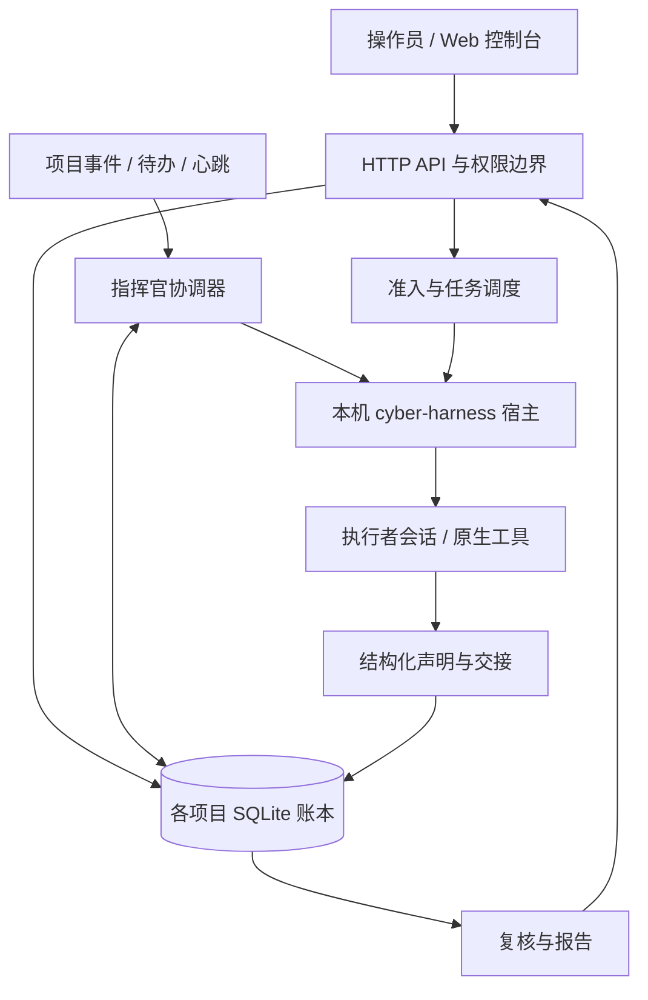

# 天吴核心架构

本文描述当前实现的职责与边界。安装、启动和操作入口见 [README](../README.md)，代码变更遵循[实现约定](../agent.md)。

## 1. 系统边界

天吴是单机、单用户、多项目的授权安全测试控制面。`tw` 在一个进程内提供 HTTP API、Web 控制台、项目账本、调度器和指挥官协调；独立构建的 cyber-harness fork 提供本机执行宿主、模型会话、工具、原生命令、Skill 发现和上下文压缩。

天吴决定何时允许新一轮模型调用，记录任务及证据；模型决定测试策略和分工。控制面不内置固定攻击流程，不从运行日志推断漏洞，也不复制 harness 的工具、会话或压缩实现。

## 2. 角色与执行契约

操作员定义项目目标、授权范围、测试时段和禁止动作，决定启动、暂停及人工授权。指挥官可以请求停止整个项目（持久暂停，只由操作员恢复），但不能启动、恢复或追加目标；执行者不能停整个项目，只能把判断交回指挥官。可编辑的项目约束文档只表达这些边界，例如禁止删改目标业务数据；它不承担通用角色提示词的职责。

指挥官在 harness 长会话内读取项目目标与状态，组织方向、派发和协作、处理待办并判断是否完成。内置 commander Skill 规定证据标准、版本意识和职责。执行者只取得自己的意图、稳定约束、验收标准、上下文及交接契约，不接收整份项目目标或内部评测备注。

每条结论必须关联可复核的原始证据。无法保留证据的内容只登记为线索，不能表述为已验证结论；是否复核及复核哪一版断言由账本决定。目标输出、文件和网页内容属于待分析数据，不构成操作员授权。复核器按验收标准检查证据，报告引用账本中的当前记录。

前提准入只有 `verified_only` 一种：全部必要前提须当前断言已独立核验。旧清单里的 `standard` / `strict` 在加载时一次性迁移为 `verified_only` 并写回清单；不存在标准模式的只读兼容路径，也不再接受 `standard` 写入。

## 3. 持久数据模型

各项目位于 `<data>/projects/<id>`，使用 `ledger.sqlite` 作为事务状态来源，工作目录、原始证据和会话材料与账本分开保存。目录 `<id>` 是短随机标识（`p-xxxxxxxx`），与项目显示名解耦：改名不移动目录，名称/简报里的目标域名也不会进入路径或控制台 URL。当前版本要求匹配的 SQLite schema；不在启动时自动导入旧 JSON 数据。

| 对象 | 职责 |
| --- | --- |
| Goal / Intent | 项目目标、可验收的工作方向、前提、依赖与状态 |
| Fact / Evidence | 显式声明、有限派生、原始材料与断言版本 |
| Run | 一次有账本记录的执行，含模型、状态、用量及停止原因 |
| Review | 绑定具体断言版本的复核结果 |
| Instruction / Context | 持久指令、引用、固定项及上下文选择 |
| Message / Delivery | 协作消息、状态变化交付及确认 |
| Access / Action | 人工访问前提、外部动作状态、幂等身份及未知结果 |

记录版本用于并发更新检查；断言版本用于判断既有复核是否仍适用。修改断言不会把旧复核自动带到新版本。来源日志和观察事件不会自动晋升为发现。图关系表达依赖、引用和固定上下文，不能把“存在一条边”解释为其内容已被证明。

每个项目只有一个由操作员在创建或追加时定义的终点目标：创建项目时写起点与终点（起点进入项目简报，终点是可判真假的最终状态），追加目标也只能由操作员显式操作；两者都是操作员的自然语言，控制面不做量化评分。指挥官与执行者不创建、不改写目标：它们只做测试、按目标判断是否达成并推进。未达成终点不画进链路、也不连线，只在图谱左下「终点」卡显示；达成后接到承载证据的事实上。

## 4. 运行生命周期与准入

执行者从意图派发为 Run，取得当时的前提与上下文。运行中的声明经 API 写入账本，结束时提交结构化交接。等待子任务时按协作协议让出槽位，依赖就绪后由调度器续接；取消与停止原因保留为显式状态。

项目暂停、模型暂停、宿主就绪、并发容量和前提状态共同决定是否允许新调用。运行中的任务不会因为某个配置被暂停就被强行终止。原生闲置消息留在邮箱，只有经过天吴准入并记录的续轮才能开启模型调用，避免账本外自动续跑。

进程重启后项目默认保持暂停，操作员检查现场后恢复。任务状态、事实和交付有持久记录；部分指挥官会话周期信息及暂停说明仍依赖进程内状态，不能视为完整的分布式恢复协议。

## 5. 长会话与状态检索

指挥官保留长会话以接续推理，账本作为外部持久记忆。概览只提供必要索引，正文、历史、证据和任务子图按需读取；冻结快照通过游标分页，避免跨页读到不同版本。控制台图谱固定在一份完整快照上：默认每 6 秒探测账本变化并自动换入新快照（可关闭实时刷新），刷新只整体切换快照，不跨版本拼接页面；换快照会回到首屏批次，相机位置保留，未达成终点不上图（左下终点卡），达成后接到承载证据的事实上。图谱按账本状态着色：未满足的硬门槛（前提事实未核验、不可复核或缺失）是虚线红，实线红只表示正在执行。

上下文接近交接阈值时，指挥官完成交接并记录 STATE；下一轮交接提示使用一次性状态，“本周期已交接”和“上一轮是交接轮”分别记录，避免从交接到 harness 压缩之间每轮重复注入全文。实际会话压缩由 harness 完成。

变化交付记录尝试次数、下次重试时间及上次展示的 Run。未确认交付按退避契约重试，心跳依据持久状态判断是否需要唤醒，不依靠提示词要求模型记得确认来抑制重复完整轮次。

## 6. 协作与唤醒

同项目执行者可交换结构化消息、委派子任务、等待结果及请求人工访问。父子任务、等待关系和交接保存在控制面，原生工具负责实际执行。消息传输状态与任务完成、结论复核是不同概念。

项目事件、持久待办和空闲心跳进入指挥官协调器，经过合并与准入后开轮。幂等身份避免重复提交同一操作；结果未知的外部动作不会自动重放。项目暂停期间待办保留，恢复后按当前状态处理。

指挥官判断项目不应继续（目标不可达、授权阻塞、继续推进只会空转）时可以请求全局停止：项目进入持久的“指挥官请求停止”暂停、在跑方向取消，发起本轮正常收尾并把本轮事件交付结清；恢复仍只有操作员的显式「继续项目」。这避免指挥官只能停放方向、随后又因该结果被自动唤醒，空耗一轮 token。全局停止只能由发起请求的那一个指挥官轮次声明：控制面要求请求来自 harness 会话、带指挥官身份声明，并且存在进行中的指挥官轮次可供归因；执行者会话不能停整个项目。暂停原因（操作员暂停 / 目标完成待命 / 指挥官请求停止）与暂停标志一起持久化，控制面重启后控制台仍能显示是谁停的项目，只有操作员恢复才会清除。

## 7. 模型与宿主

模型配置保存在 harness 用户配置中，控制台提供配置、默认选择、层级、容量和 API key 轮换管理。不同配置可复用或启动对应的本机宿主。默认宿主与审计调用通过显式 `--config` 读取过滤后的运行配置副本，命名配置宿主读取单配置副本；启动和保存设置后的重启均使用这条边界。原文件及其暂停与调度元数据保留，harness 的严格解析器只接收运行字段。

`paused` 是持久布尔字段。暂停保留配置、默认绑定和现有宿主，后端拒绝显式指定该配置的新调用。执行者、指挥官及复核、报告继承的默认模型被暂停时，优先选择配置的 fallback，再尝试实例默认及配置目录中的其他可用模型；跳过暂停、配置不完整或已确认不可用的配置，无可用替代时明确报错。替代模型通过独立宿主执行，运行记录反映实际绑定；恢复后新请求重新使用原默认，不终止或重放已有请求。

模型目录查询与连通性检测分开：前者辅助选择名称；后者由操作员显式触发一次轻量推理请求，必须取得有效响应才报告成功。展示的响应模型名称只取接口原始字段，缺失时不以配置名称补齐。成功不证明工具调用、长上下文或目标操作能力。读取设置不会自动发起真实推理。

## 8. 复核、报告与完成边界

线索、声明、已复核断言和报告引用需要区分。复核绑定断言版本，报告应保留来源与证据，使操作员可以回到原始材料核验。收尾窗口让已派发工作完成交接，并把新增声明纳入最终检查；投递成功本身不等于目标完成。

复核是成功意图的固定结算阶段，不是可选的自动开关：方向成功结束后进入 `reviewing`，该方向尚未核验的 `vuln`/`cred` 结论（有证据的）由独立复核者重跑；通过后才 `done`，未通过或没有原始证据则进入 `review_failed`，由指挥官在原意图上 `retry`/`continue`，重试会重新处理该方向仍未解决的失败事实。复核集合属于方向而不是某一次 run：先让出子任务再被唤醒续跑、进程崩溃后的对账恢复、以及 retry/continue 都不会漏掉更早的结论。`note` 永不复核；`host`/`service`/`loot`/`artifact` 只在下游将其写入 `from_fact_ids` 时按需复核。按需复核失败会在 readiness 显示 `failed`，自动队列不会对同一断言版本无限重试；修正断言或操作员手动复核才能再次进入。所有项目固定 `verified_only`，旧 `standard` 清单在加载时自动迁移。复核暂停是操作员急停：进行中的固定复核挂起而不判失败，方向保持 `reviewing`，恢复复核后自动续跑；只有复核完成且结论未通过、或结论没有原始证据，才进入 `review_failed`。不存在自动复核开关。

存在等待复核的前提门禁时，会话创建的无前提方向只有两种情况以 `hold + bootstrap` 创建：引用的 `interest_entity_refs` 已在账本里有事实，或没有写实体身份。新实体首触在 `interest_entity_refs` 中写明账本中尚不存在的实体即可直接放行；因此不相关的新目标不会被误卡，也不能用“另开根方向”绕过未完成的复核。重开/重试同一方向不会改变其 from_fact_ids，仍要过前提复核。

报告生成与交付是操作员侧的后处理：报告 run 只读账本快照与证据原件，由控制台显式触发，不依赖指挥官或执行者的会话状态。指挥官与执行者只负责测试本身，报告/复核的运行、输出与队列不出现在其 API 视野中（`/api/runs` 过滤 support purpose，`/api/artifacts`、`/api/traffic` 过滤 support run 的原生产物与抓包，board 不返回复核队列，`handoff_warnings` 不列 support run）。会话仍可从意图的 readiness 读取必要前提的派生复核状态（排队、进行中、冷却、暂停、未通过、未启用或不可复核）及一句处理提示：该状态用于等待或请操作员处理；它不含复核运行、输出与队列本身，也不给会话触发复核的入口；readiness 里的 `review_id`/`verifier_run` 只是断言回执标识，不是复核运行入口（run 内容端点对会话保持 404）。board 可以列出方向的 `reviewing`/`review_failed` 状态——那是方向生命周期，不是复核运行或队列。心跳、看门狗节拍、最后一次唤醒、轮次/用量/存活统计和 guard 脉冲属于控制面调度，不进入指挥官的 board 视图——会话的 board 只保留“指挥官是否启用、是否暂停、暂停原因”这类可操作的运行状态；会话只看到实际的 board 状态和明确发给它的消息。复核与报告共享一个实例级辅助模型并发（默认 1，即串行；可在设置中调整），不占执行者并发名额。

当前收尾仍有结构性限制：窗口内新增声明和显式未完成项尚未统一为独立结果契约；跨焦点、经验、图和报告的所有引用也尚未收敛成同一种版本结构。实体身份检索与跨分支旧事实引用仍需谨慎核验。

## 9. 验证层级与已知限制

Go 测试覆盖账本、调度、准入、状态检索与交付协议；前端测试覆盖状态转换、版本冲突和组件交互。假模型、合成图与离线界面样本只验证协议和产品行为。显式启用的真实 harness 集成测试验证适配与 Skill 展开，真实测试效果需要在授权且隔离的目标上独立验收。

控制台令牌具备本机执行权限，模型工具不受本项目提供的文件系统沙箱保护；授权资产范围不是逐请求的强制过滤器。模型输出与第三方内容都需审查。

长时程项目的变更历史加载、账本复制成本及复核队列的依赖优先级仍有优化空间。当前不建设多用户、多租户或远端执行集群，不承诺完整无人值守、自动发现率或业务安全保证。
